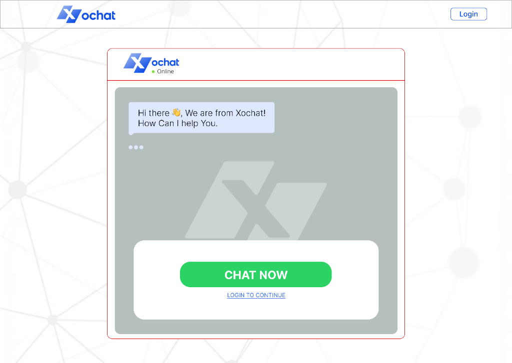
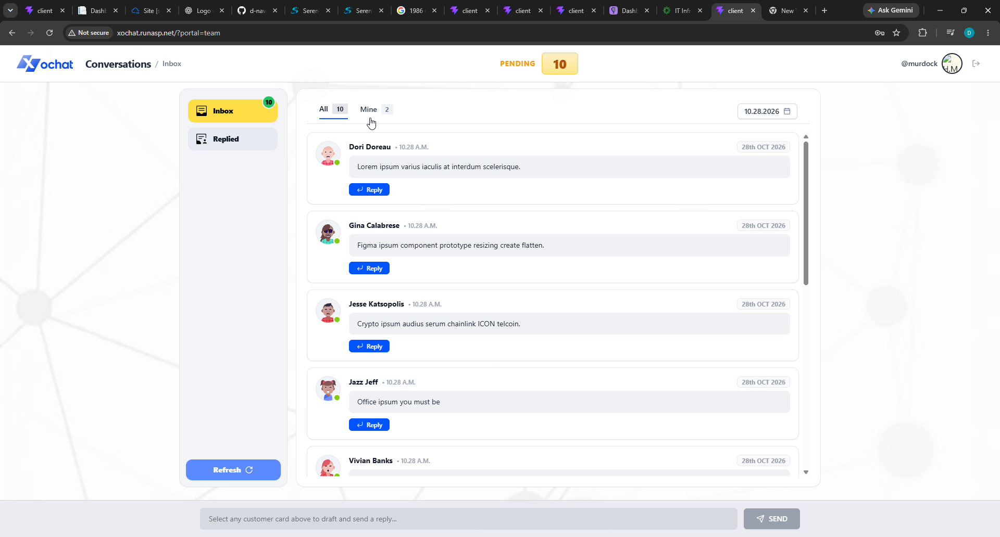
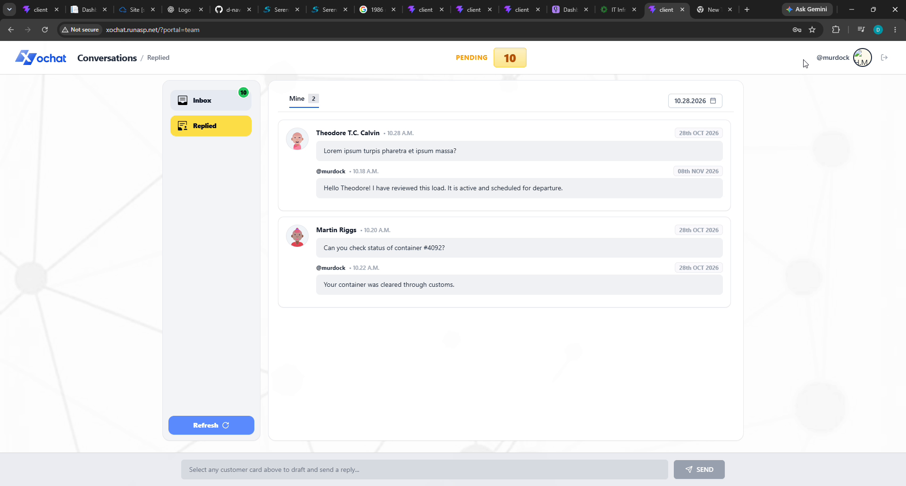
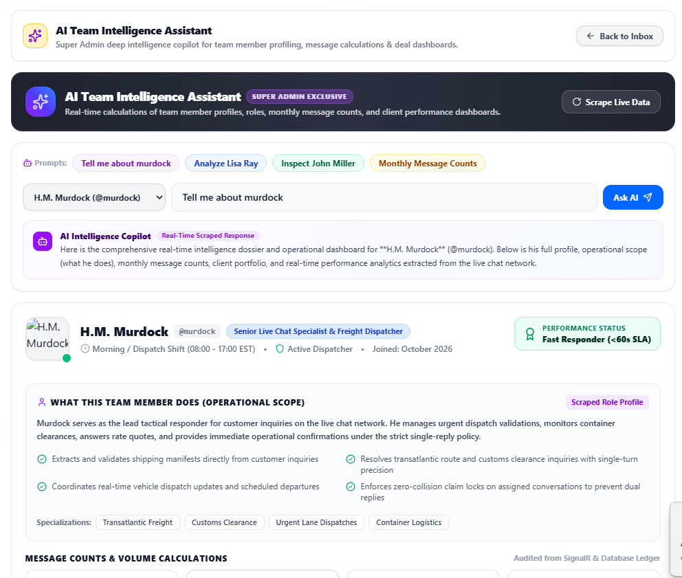
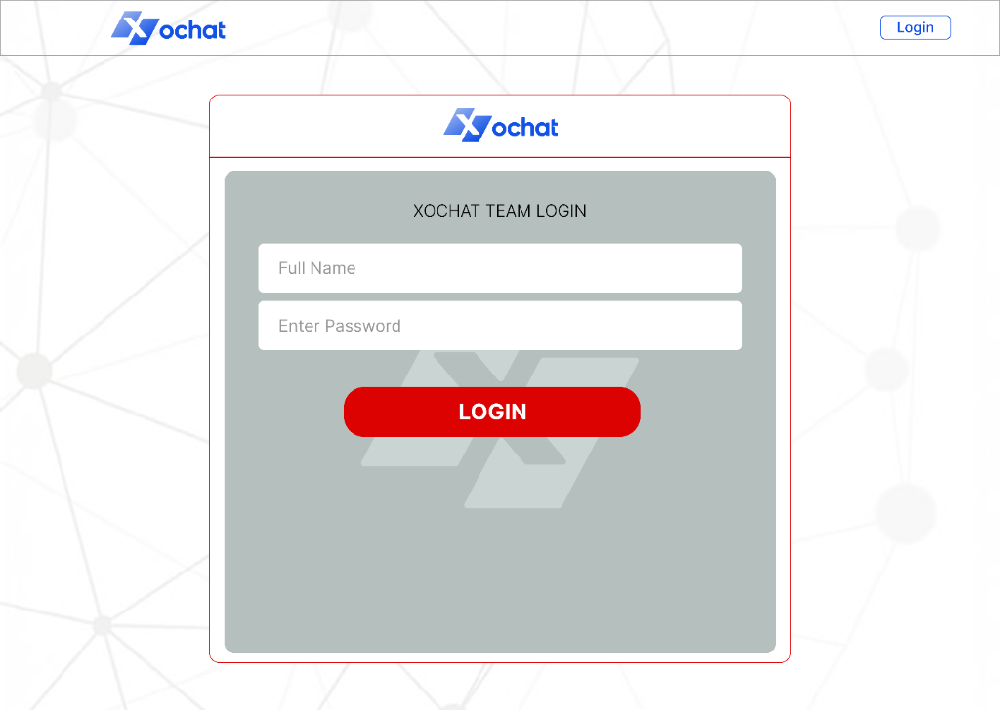

# ⚡ Xochat | Enterprise Multi-Portal Live Chat & HelpDesk

<p align="center">
  
</p>

<p align="center">
  <strong>Enterprise-Grade Real-Time Live Chat Platform with Atomic Collision Prevention, Multi-Role Portal Isolation, and AI Intelligence Surveillance.</strong>
</p>

<p align="center">
  
  
  
  
  
  
</p>

---

## 📸 Platform Screenshots

### 1. Customer Live Chat Portal (Public Gateway)
> *Clean, customer-first onboarding and live messaging interface. Both team login and admin panels are 100% hidden from clients.*
<p align="center">
  
</p>

### 2. Team Members Live Chat & Pending Queue
> *High-velocity agent inbox with real-time pending badges, customer inquiries, and instant exclusive reply locks.*
<p align="center">
  
</p>

### 3. Replied Box & Historical Date Proof
> *Strict agent reply isolation with full chronological timestamps (`Time` + `Date`) providing indisputable audit proof.*
<p align="center">
  
</p>

### 4. AI Team Intelligence Copilot & Surveillance
> *Super Admin executive suite featuring live scraped agent dossiers, SLA response calculations, and CRM pipelines.*
<p align="center">
  
</p>

### 5. Dedicated Staff Authentication
> *Branded authentication gateway isolated from external customer view.*
<p align="center">
  
</p>

---

## 🏛️ Dedicated Portal Isolation Architecture

Xochat separates customer engagement, support operations, and administrative oversight into dedicated, isolated entry points:

| Portal | Dedicated URL | Target Audience | Key Capabilities |
| :--- | :--- | :--- | :--- |
| **Client / Customer** | **`/`** or `/customer`<br>*(Port 3002)* | Customers & Visitors | Customer chat window, account registration/login, live inquiry status, and real-time response delivery. **Zero administrative links exposed.** |
| **Team Members** | **`/team`** or `/agent`<br>*(Port 5121)* | Support Agents (`@murdock`, `@lisa`) | Pending queue (`All`), agent-assigned inquiries (`Mine`), Replied box, collision locks, one-reply enforcement, and instant date filtering. |
| **Admin & Executive** | **`/admin`** or `/super`<br>*(Ports 5120 / 5720)* | Super Admin & Core Admin | AI Team Intelligence Copilot, live agent surveillance, real-time activity scraping, CRM deal stages, and message audits. |
| **Backend Engine** | **`/api` & `/chatHub`**<br>*(Port 4000)* | Real-Time Engine | ASP.NET Core (.NET 10) + SignalR WebSockets, Lock Manager, Auto-Assign Engine, and JWT Authentication. |

---

## ⚡ Core Enterprise Features

### 🔒 1. Atomic Collision Prevention & Reply Locking
- When an agent selects a customer inquiry to reply, an exclusive lock (`claim:lock`) is granted via SignalR.
- If another agent attempts to reply simultaneously, the collision engine blocks the action with a real-time collision toast alert:
  > *"Chat is currently locked by @murdock (H.M. Murdock)"*
- Locks auto-expire safely to prevent orphaned chats.

### ✉️ 2. Strict Single-Reply Rule
- Team members are permitted to send **strictly one reply** per customer inquiry.
- Once answered:
  1. The green unreplied indicator is immediately removed.
  2. The customer inquiry moves automatically from the pending **All** feed into the **Replied Box**.
  3. Subsequent attempts to send additional replies are rejected by the backend.

### 📅 3. Comprehensive Date Filtering & Audit Proof
- Support agents and admins can filter conversations by date (e.g., `10.28.2026`).
- Inquiries and replies maintain exact formatted timestamps (`10.28 A.M. • 28th OCT 2026`), providing proof of when each message was exchanged.

### ⏱️ 4. Instant 0ms Tab Switching
- Inbox collections (`All`, `Mine`, `Replied`) are pre-segmented and reactively derived in memory.
- Switching between tabs takes **0 milliseconds** with zero network race conditions.

---

## 🛠️ Technology Stack

- **Backend**: ASP.NET Core (.NET 10.0), C#, SignalR (Persistent WebSockets), JWT Bearer Authentication, BCrypt.
- **Frontend**: React 19, TypeScript, Vite, Tailwind CSS v4, `@microsoft/signalr`, Lucide Icons.
- **Data Layer**: Embedded JSON Document Store (`Data/db.json`) with thread-safe locking and automatic backups.
- **Hosting**: MonsterASP.NET IIS InProcess, Docker, or standalone Kestrel.

---

## 🚀 Local Development Setup

### Prerequisites
- [.NET 10 SDK](https://dotnet.microsoft.com/download/dotnet/10.0)
- [Node.js (v20+ recommended)](https://nodejs.org/)

### 1. Install Dependencies
```bash
npm install
npm --prefix client install
```

### 2. Launch All Services (Multi-Port Mode)
Run the consolidated orchestrator to start backend and all 4 portal instances simultaneously:
```bash
npm run start:all
```

Or run individual services:
```bash
npm run dev:backend   # ASP.NET Core API & SignalR on :4000
npm run dev:customer  # Customer Chat Portal on :3002
npm run dev:team      # Team Members Live Chat on :5121
npm run dev:core      # Core Admin Portal on :5120
npm run dev:super     # Super Admin Portal on :5720
```

---

## 🧪 Automated QA Concurrency & Rule Verification

The platform includes an automated end-to-end verification suite testing real-time WebSocket claims, atomic collision locks, single-reply limits, date filtering, and admin audit logging:

```bash
npm run test:qa
```

**Results:**
```
================================================================
   XOCHAT .NET 10 ENTERPRISE LIVE CHAT QA VERIFICATION SUITE
================================================================
[PASS] 1. Initial pending count matches mockup.
[PASS] 2. Customer avatar has active GREEN status indicator.
[PASS] 3. Atomic Collision Lock prevented duplicate agent assignment.
[PASS] 4. Green mark removed and chat moved to Replied Box.
[PASS] 5. Strictly enforced single-reply rule.
[PASS] 6. Customer repeated messaging constraint verified.
[PASS] 7. Automated HelpDesk Auto-Assigning Agents engine verified.
[PASS] 8. Admin Surveillance & Scraping trace verified.
================================================================
   ALL .NET 10 QA VERIFICATION TESTS PASSED SUCCESSFULLY (100%)
================================================================
```

---

## ☁️ 1-Click MonsterASP.NET Deployment

To package the entire platform (Frontend React SPA + Backend .NET 10 SignalR) for **MonsterASP.NET**:

```bash
npm run publish:monsterasp
```

This compiles both frontend and backend and generates a lightweight zip:
```
D:\live_chat\publish-monsterasp.zip (~1.27 MB)
```

1. Log into your [MonsterASP.NET](https://monsterasp.net) Control Panel.
2. Ensure **.NET 10** is selected under your website's **Scripting** settings.
3. Open **File Manager** → navigate to the website root (`/site/wwwroot/`).
4. Upload `publish-monsterasp.zip` and click **Extract**.
5. Your live chat system is live with full WebSocket support!

---

## 📄 License
MIT License. Built for enterprise high-velocity live chat operations.
